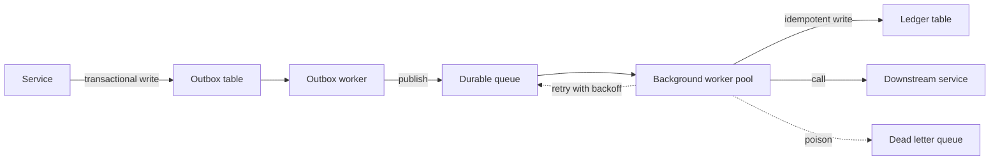
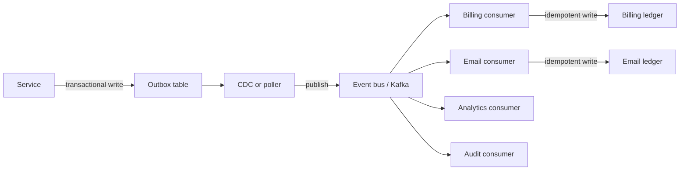

Here's a scene I walked into twice in one year.

Two teams. One wants "event-driven architecture." The other is skeptical but polite. Someone draws Kafka in the middle. Three months later, the Kafka cluster is running, monitored, and mostly idle. The actual integration problem is still being debugged on Slack because retry logic lives in four different services and nobody can explain what happens when the webhook fails twice.

Nobody lied. They just skipped past a cheaper answer: a durable queue, a pool of workers, and a ledger that refuses to do the same irreversible thing twice.

## What I mean by boring

Not "we have no requirements."

Boring is when the parts already exist, the failure modes are knowable, and on-call doesn't need a PhD.

In practice, for **most** service integrations on platforms I've worked on, boring looks like:

- **A durable queue** (RabbitMQ, SQS, Azure Service Bus, Postgres `SKIP LOCKED`, any job store that survives a crash)
- **Background workers** that pull, do the work, and ack when it's done
- **An idempotent ledger** so retries can't charge the same invoice twice or send the same email three times

You add:

- idempotency keys (UUID or natural key)
- retries with exponential backoff
- dead-letter handling for poison messages
- maybe one outbox table if you need transactional guarantees

That's it. You don't design topics. You don't explain partitions to product. You don't have a broker topology review.

## A concrete case: billing a citizen service

Say a Digital Government Platform charges for document verification. The orchestrator finishes the workflow. You need to:

1. Create an invoice in the billing service.
2. Send a confirmation email.
3. Update a public ledger (optional: sometimes there's an audit trail).

Synchronous calls from the orchestrator would work until any downstream service is slow or restarting. You want async.

### Boring version: queue + worker + ledger

The orchestrator writes one row to an **outbox table** in the same transaction that marks the workflow complete. A separate outbox worker polls that table and pushes messages to a durable queue. Each message carries a unique `idempotencyKey` (either a UUID or derived from `workflowId + "billing"`).

```ts
// Outbox worker (or CDC, same idea)
async function processOutbox() {
  const pending = await db.query(
    `SELECT * FROM outbox WHERE processed_at IS NULL ORDER BY created_at LIMIT 10`
  );

  for (const row of pending) {
    await queue.send({
      type: 'workflow.completed',
      idempotencyKey: row.idempotency_key,
      payload: row.payload,
    });

    await db.query(
      `UPDATE outbox SET processed_at = NOW() WHERE id = $1`,
      [row.id]
    );
  }
}
```

A **billing worker** consumes from the queue:

```ts
async function handleWorkflowCompleted(msg: WorkflowCompletedMessage) {
  // Check ledger first: if we already processed this key, ack and return
  const existing = await db.query(
    `SELECT id FROM billing_ledger WHERE idempotency_key = $1`,
    [msg.idempotencyKey]
  );

  if (existing.rowCount > 0) {
    console.log('Already processed', msg.idempotencyKey);
    return; // ack without doing work
  }

  // Create invoice
  const invoice = await billingService.createInvoice({
    workflowId: msg.payload.workflowId,
    amount: msg.payload.amount,
  });

  // Write to ledger (unique constraint prevents duplicates)
  await db.query(
    `INSERT INTO billing_ledger (idempotency_key, invoice_id, created_at)
     VALUES ($1, $2, NOW())
     ON CONFLICT (idempotency_key) DO NOTHING`,
    [msg.idempotencyKey, invoice.id]
  );

  // Queue follow-up (email, audit log) with their own idempotency keys
  await queue.send({
    type: 'invoice.created',
    idempotencyKey: `${msg.idempotencyKey}-email`,
    payload: { invoiceId: invoice.id, email: msg.payload.email },
  });
}
```

The email worker does the same: check the ledger, send if new, write the proof.

When the billing service is down, the worker retries with backoff. When the message is poisoned (bad JSON, missing required field), it lands in a dead-letter queue after N attempts. On-call looks at dead letters once a day, not every retry.

### What this is not

- Not "eventual consistency is scary": you already have that the moment you go async.
- Not "queues can't scale": if one worker is slow, add more; if you hit broker limits years from now, migrate the hot path.
- Not "no events": the messages are small events. You just didn't need topics and partitions yet.

## Decision table: queue vs event bus vs sync

| Concern | Durable Queue + Workers | Event Bus (Kafka, etc.) | Synchronous Calls |
| --- | --- | --- | --- |
| **One producer, one logical consumer** | ✅ Perfect fit | ❌ Overhead | ⚠️ Fails when downstream is slow |
| **Multiple independent consumers** | ⚠️ Fan-out via multiple queues works but feels clunky | ✅ Built for this | ❌ Doesn't apply |
| **Replay / time travel** | ❌ Once ack'd, it's gone | ✅ Offset rewind | ❌ No |
| **Transactional guarantees with DB** | ✅ Outbox pattern | ⚠️ Needs outbox or CDC anyway | ✅ In one DB call |
| **Observability of retries** | ✅ Worker logs + DLQ | ⚠️ Requires instrumentation | ⚠️ Client retry is invisible |
| **Operational complexity** | Low (queue + worker pool) | Medium to High (broker cluster, partitions, consumer groups) | Low (until it fails) |
| **Idempotency** | ✅ Ledger at worker | ✅ Ledger at consumer | ⚠️ Caller has to handle |

## When you SHOULD graduate to an event bus

Boring is not forever. Introduce Kafka (or equivalent) when:

**Multiple independent consumers need the same event.**  
Billing, notifications, analytics, and audit all care about `workflow.completed`. Fanning out via separate queues works but starts to feel like accidental pub/sub. A real event bus makes that explicit.

**You need replay or time travel.**  
Reprocessing last month's billing events to backfill a new field, or rewinding a consumer after a bad deploy. Queues don't keep history once you ack.

**Stream processing is part of the product.**  
Windowed aggregations, joining streams, stateful event enrichment. That's what Kafka Streams, Flink, and friends are for. A worker that pulls from a queue can't do that cleanly.

**Partition-level ordering matters and you have high throughput.**  
All events for citizen X must be processed in order, and you're handling thousands per second. Kafka partitions give you that. A single queue with one consumer is a bottleneck.

**You're already running it and it's boring to your team.**  
If Kafka is already in production, understood, and not causing operational pain, use it. Boring is relative.

## The architecture (both ways)

### Boring: queue + worker + ledger



### Event bus: for fan-out and replay



Both patterns need idempotency. Both need outbox if you want transactional publish. The event bus wins when you have many independent consumers or stream-processing requirements.

## Idempotent ledger: one table, one unique constraint

The simplest version is a table keyed by `idempotency_key` with a unique constraint.

```sql
CREATE TABLE billing_ledger (
  id UUID PRIMARY KEY DEFAULT gen_random_uuid(),
  idempotency_key TEXT NOT NULL UNIQUE,
  invoice_id TEXT NOT NULL,
  workflow_id TEXT NOT NULL,
  amount_cents INTEGER NOT NULL,
  created_at TIMESTAMPTZ NOT NULL DEFAULT NOW()
);

CREATE INDEX idx_billing_ledger_workflow ON billing_ledger(workflow_id);
```

The worker tries:

```ts
await db.query(
  `INSERT INTO billing_ledger (idempotency_key, invoice_id, workflow_id, amount_cents)
   VALUES ($1, $2, $3, $4)
   ON CONFLICT (idempotency_key) DO NOTHING`,
  [key, invoiceId, workflowId, amountCents]
);
```

If the key already exists, the insert is a no-op. The worker can query afterward to confirm it's there, or just log and return. The external side effect (calling the billing API) can happen **before** or **after** the ledger write, depending on your tolerance:

- **Before**: if the ledger write fails, you might double-bill (prefer retries to be safe, or make the external call idempotent too)
- **After**: if the external call fails, retry the whole handler; the ledger check skips duplicate attempts

On most platforms, I do the external call first (with its own idempotency on the receiving service when possible), then write the ledger proof. Retries are cheap. Double-charging a citizen is not.

## Practical rollout

Don't rewrite the universe on day one.

1. Pick **one** high-value async flow (billing, notifications, or webhooks).
2. Add an outbox table and a poller (or use CDC if you already have it).
3. Stand up a worker pool (can be the same NestJS app with a `Worker` mode, or a separate process).
4. Add the ledger table with the unique constraint.
5. Instrument: worker success/failure counters, DLQ alert, average retry count.
6. Only after that's boring, consider the next integration.

When you hit 5+ consumers for the same logical event, or someone asks "can we replay last Tuesday," revisit the event bus.

## Habits that keep it boring

**One idempotency key per side effect.**  
Billing and email are separate keys. Don't reuse the same UUID for two irreversible actions.

**Retries are not errors.**  
Workers retry. That's the design. Alert on **dead letters** and on retry count above a threshold (e.g. 10), not on every retry.

**Outbox or CDC, not "publish from the controller."**  
If you publish to the queue in the same HTTP handler that writes the DB, you will lose messages when the queue is down but the DB commit succeeds. Outbox makes publish durable.

**Validate the message at the worker edge.**  
Use Zod (or equivalent) to parse the message before doing work. Poison goes to DLQ. Schema drift is caught early.

**Keep the queue thin.**  
The message is a pointer and a small payload. Big data lives in storage or the DB. Workers read it fresh.

## A story from the field (without the proprietary bits)

On a Digital Government Platform with async job flows (document processing, identity verification, payment callbacks), the initial design had seven services calling each other synchronously. Timeouts were "tuned" every sprint. The ops team knew every service's retry behavior by heart because it came up in every incident.

We moved three hot paths to queue + worker + ledger. Outbox in the orchestrator. Workers in each domain service. Billing and notifications became independent. The dead-letter queue caught two message-schema bugs in the first week that would have been silent 500s before.

The win wasn't "async is better." It was "retries moved out of the critical path, and irreversible actions became provably once."

## The tradeoffs (said plainly)

You will still have eventual consistency. Debugging "where is my email" is harder than debugging a synchronous stack trace.

You need a place to run workers. Kubernetes sidecars, separate pods, or serverless functions with concurrency 1. All work; all have costs.

The outbox poller is another thing to monitor. CDC (via Debezium, logical replication, or change feeds) removes the poller but adds a streaming dependency.

Idempotency keys must be chosen carefully. Natural keys (workflowId + action) are better than random UUIDs when you want to deduplicate retries that span deploy boundaries.

And queues don't give you time travel. Once you ack, it's gone. That's fine until product asks "can we reprocess March?"

## The point

Boring is not a compromise. It's a feature.

A durable queue + background workers + an idempotent ledger solves most integration problems with parts you already understand. Retries happen off the request path. Duplicate side effects are rejected by a unique constraint. Dead letters are visible.

Event buses earn their complexity when you need fan-out to many independent consumers, replay, or stream processing. Until then, the boring stack is faster to ship, easier to debug, and kinder to on-call.

If you're wiring integrations on a platform with irreversible side effects (billing, emails, webhooks, external APIs), that trio is one of the cheapest reliability patterns I've found.

---

*For architects and Staff/Principal engineers on NestJS / TypeScript platforms. Examples are illustrative.*
