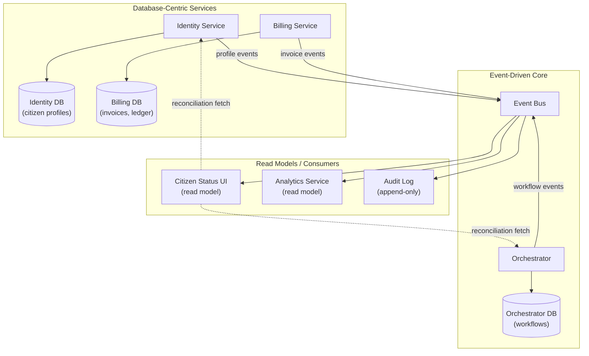

Here's a question that shows up in almost every platform architecture review.

"Who owns the state for this entity?"

Not "where does it live" that's easy. The hard part is: which system is allowed to **change** it without asking permission, and what happens when the other side falls behind?

On platforms that started with a relational core and added async flows later (or started event-driven and realized some queries need joins), you end up with a hybrid. Part of the platform treats the database as the source of truth. Part of it streams events. Citizen-facing workflows often span both. Getting that seam wrong is how you end up with "the event says completed but the database says pending" bugs that take two teams and a Friday night to untangle.

## The two mental models

### Database-centric: the service owns the table

One service, one schema, one set of domain rules. Other services can read via an API, but they cannot write directly. When something changes, that service decides whether the write is valid, commits it transactionally, and maybe publishes a notification afterward.

Queries are easy. Joins are cheap. Transactions are real. The service is the system of record.

### Event-driven: the stream is the truth

State is derived from a log of immutable facts. Services publish what happened. Consumers build their own projections (read models). When you need the current state, you replay or query a materialized view.

Temporal queries are natural ("what did this look like last Tuesday?"). Fan-out to independent consumers is cheap. There is no single write coordinator.

### Hybrid: both, with boundaries

Most Digital Government Platforms are not purely one or the other. You have:

- a citizen identity service with a database that owns user profiles
- a workflow orchestrator that publishes events when steps complete
- an audit log that is append-only and event-sourced
- a billing service with a ledger (database) and a queue for async jobs
- citizen-facing UIs that need "current state" screens and real-time status updates

The question is not "which paradigm wins." It's **where do you draw the line, and how do the two sides stay consistent?**

## The ownership table (per entity, be specific)

For every meaningful entity, answer:

| Entity | System of Record | Write Authority | How Others Learn | Consistency Mechanism |
| --- | --- | --- | --- | --- |
| **Citizen profile** | Identity service DB | Identity service only | Event: `profile.updated` | Outbox → event bus |
| **Workflow state** | Orchestrator DB | Orchestrator only | Event: `workflow.stepCompleted` | Outbox → event bus |
| **Invoice** | Billing service DB | Billing service only | Event: `invoice.created` | Outbox or queue |
| **Audit entries** | Event log (append-only) | Any service can publish | Direct read from log | N/A (append-only) |
| **Citizen-facing status** | Derived (read model) | Workflow events + identity events | Rebuilt from stream | Eventual consistency, reconciliation job |

The pattern: **one writer, many readers.** Readers get notifications or projections, not write access.

When two services need to coordinate a write (rare but real think cross-cutting transactions), you either:

- make one service the coordinator (it calls the other and handles rollback)
- or use a saga (orchestrated or choreographed, depending on complexity)

Do not let both services update the same logical entity independently and hope for the best.

## Events as notifications vs events as state

This distinction matters in hybrid systems.

### Notification events

"Something happened. If you care, go read the current state from the owning service."

```json
{
  "type": "profile.updated",
  "citizenId": "abc-123",
  "timestamp": "2026-10-30T10:15:00Z",
  "version": 42
}
```

The event is small. The consumer calls `GET /citizens/abc-123` to fetch the current profile. The database is still the truth.

Good when:

- the payload is large or changes frequently
- you want consumers to always get the latest version (even if they're catching up after downtime)
- the owning service's API is fast and stable

### State-carrying events

"This is what the new state is. You can build a local projection without calling back."

```json
{
  "type": "profile.updated",
  "citizenId": "abc-123",
  "timestamp": "2026-10-30T10:15:00Z",
  "version": 42,
  "payload": {
    "email": "citizen@example.com",
    "phone": "+1234567890",
    "preferences": { "language": "en" }
  }
}
```

Consumers build a read model locally. They do not need to call the identity service for every query.

Good when:

- consumers need fast local reads (especially for joins)
- network calls to the owning service would be too slow or chatty
- you can tolerate eventual consistency

### When to use each

Use **notification events** when the consumer needs the freshest state and the API call is cheap.

Use **state-carrying events** when consumers need fast local reads and can rebuild from the stream.

On platforms with citizen-facing workflows that span identity, orchestration, and billing, you often see both:

- identity publishes state-carrying events (consumers need name and contact info for screens)
- orchestrator publishes notifications (consumers query the orchestrator API for full step details)

The rule: whoever owns the write decides what's in the event. Consumers adapt.

## The outbox pattern (for transactional publish)

Publishing an event **after** a database commit is not atomic. If the publish fails, the database moved forward but nobody else knows. If the process crashes between commit and publish, the event is lost.

The **outbox pattern** makes publish durable:

1. In the same transaction that changes the domain table, insert a row into an `outbox` table.
2. A separate poller (or CDC) reads the outbox and publishes to the event bus.
3. Mark the outbox row as processed.

```sql
-- Domain transaction
BEGIN;

UPDATE citizen_profiles
SET email = 'new@example.com', version = version + 1
WHERE citizen_id = 'abc-123';

INSERT INTO outbox (id, event_type, payload, created_at)
VALUES (gen_random_uuid(), 'profile.updated', '{"citizenId": "abc-123", "version": 42}', NOW());

COMMIT;
```

Outbox worker:

```ts
async function processOutbox() {
  const pending = await db.query(
    `SELECT * FROM outbox WHERE published_at IS NULL ORDER BY created_at LIMIT 50`
  );

  for (const row of pending) {
    await eventBus.publish(row.event_type, JSON.parse(row.payload));

    await db.query(
      `UPDATE outbox SET published_at = NOW() WHERE id = $1`,
      [row.id]
    );
  }
}
```

Alternative: **Change Data Capture (CDC)** via Debezium, logical replication, or cloud change feeds. CDC removes the outbox table by streaming the commit log directly. It's more magical and more operationally complex. Outbox is boring and works everywhere.

## Read models and reconciliation

When consumers build local projections from events, those projections can drift (missed events, bugs, out-of-order delivery, schema changes).

Two habits:

**Version or timestamp events.**  
Include a monotonic version or timestamp so consumers can detect gaps.

```json
{
  "type": "profile.updated",
  "citizenId": "abc-123",
  "version": 42,
  "timestamp": "2026-10-30T10:15:00Z"
}
```

If the consumer's last known version is 40 and the next event is 42, something is missing.

**Run a reconciliation job.**  
Periodically compare the read model to the system of record. For every citizen in the projection, fetch the current version from the identity service. If they don't match, log the diff and rebuild.

This is not a sign of failure. It's a safety net for distributed systems.

Reconciliation can be:

- a nightly batch job (cheap, simple)
- triggered by a manual repair command
- part of a circuit breaker (if drift crosses a threshold, pause and rebuild)

## A hybrid architecture sketch



**Who owns what:**

- Identity service: authoritative for citizen profiles (DB)
- Orchestrator: authoritative for workflow state (DB, publishes events)
- Billing service: authoritative for invoices (DB, publishes events)
- Event bus: notification layer
- Read models: eventual-consistency projections, reconcile periodically

## Citizen-facing workflows that span both

Say a citizen submits a document verification request. The flow crosses:

1. **Orchestrator** creates a workflow (DB write, event published).
2. **Identity service** checks the citizen's profile (DB read, maybe an event if profile is updated).
3. **External adapter** verifies the document (async, publishes event when done).
4. **Orchestrator** marks the step complete (DB write, event published).
5. **Billing service** creates an invoice (DB write, event published).
6. **Citizen status UI** shows "completed" (read model, rebuilt from events).

Each service owns its write. Events flow between them. The UI never writes directly; it rebuilds from the stream.

When the billing service is down, the workflow completes and the event is published. Billing catches up later. The citizen sees "completed" even if the invoice is pending. That's eventual consistency, and it's the design.

If you need stronger guarantees (citizen cannot see "completed" until billing confirms), coordinate it:

- orchestrator waits for billing to ack before marking the workflow done (synchronous call or saga)
- or billing becomes part of the workflow graph (orchestrator invokes it as a step)

Choose based on the domain requirement, not religion.

## Reconciliation example (TypeScript)

```ts
// Reconciliation job for citizen status read model
async function reconcileCitizenStatus(citizenId: string) {
  // Fetch current state from systems of record
  const [profile, workflows] = await Promise.all([
    identityClient.getProfile(citizenId),
    orchestratorClient.listWorkflows({ citizenId }),
  ]);

  // Fetch our local read model
  const readModel = await db.query(
    `SELECT * FROM citizen_status_view WHERE citizen_id = $1`,
    [citizenId]
  );

  // Compare versions
  if (readModel.profile_version !== profile.version) {
    console.log('Profile drift detected', {
      citizenId,
      expected: profile.version,
      actual: readModel.profile_version,
    });

    // Rebuild from source
    await db.query(
      `UPDATE citizen_status_view
       SET profile_version = $1, email = $2, updated_at = NOW()
       WHERE citizen_id = $3`,
      [profile.version, profile.email, citizenId]
    );
  }

  if (readModel.workflow_count !== workflows.length) {
    console.log('Workflow count drift detected', {
      citizenId,
      expected: workflows.length,
      actual: readModel.workflow_count,
    });

    // Rebuild workflow summary
    await rebuildWorkflowSummary(citizenId, workflows);
  }
}
```

Run this:

- nightly for all active citizens
- on-demand when support sees a mismatch
- as part of a health check before high-value operations

## Failure modes and what breaks first

| Failure | What Happens | How to Detect | How to Fix |
| --- | --- | --- | --- |
| **Event lost (publish failed)** | Read models drift, never catch up | Reconciliation job finds version gaps | Republish from outbox or trigger a rebuild |
| **Consumer lag** | Read models are behind but will catch up | Consumer offset monitoring | Scale consumers, optimize processing |
| **Two services think they own an entity** | Conflicting writes, data corruption | Outages, support tickets, reconciliation alarms | Clarify ownership, make one authoritative |
| **Outbox poller down** | Events stop flowing, DB is ahead | Event publish rate drops to zero | Restart poller, clear backlog |
| **Read model rebuild on corrupt state** | Consumer sees stale or wrong data | User reports, reconciliation diff | Wipe read model, replay from stream or fetch from source |

## The point

Hybrid architectures are not a compromise. They're a deliberate choice.

Database-centric services own entities and expose them. Event-driven flows compose those entities and react to changes. The seam between them is **who can write, who can read, and how they stay in sync.**

For each entity, pick one system of record. Let others subscribe or query. Use outbox or CDC to make publish durable. Build read models when you need fast local queries. Reconcile when drift is inevitable.

On Digital Government Platforms where citizen workflows span identity, orchestration, billing, and audit, clarifying that seam early is cheaper than debugging "which is the real state?" incidents later.

---

*For architects and Staff/Principal engineers on NestJS / TypeScript platforms. Examples are illustrative.*
